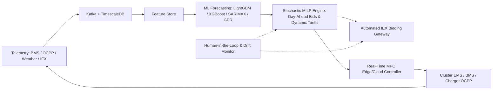

# VoltEdge-India

**AI-powered energy allocation, BESS optimization, and dynamic pricing for Indian EV charging & battery-swapping clusters in the IEX market.**

VoltEdge-India is an end-to-end decision framework designed to sustain profitability (targeting **>12% EBITDA margins**) under volatile Indian Energy Exchange (IEX) Day-Ahead (DAM) and Real-Time (RTM) prices, intermittent renewable generation, battery degradation, a **±20% daily retail tariff corridor**, and a strict **5% uncommitted emergency reserve**.

---

## Table of Contents
1. [Problem Statement](#problem-statement)
2. [System Architecture](#system-architecture)
3. [Core Methodology](#core-methodology)
4. [Repository Structure](#repository-structure)
5. [Quick Start](#quick-start)
6. [Baseline Parameters](#baseline-parameters)
7. [Scenario Benchmarking](#scenario-benchmarking)
8. [Key Constraints & Guardrails](#key-constraints--guardrails)
9. [Roadmap](#roadmap)

---

## Problem Statement

Indian EV charging and battery-swapping operators face four simultaneous operational pressures:
* **Wholesale Volatility:** IEX DAM/RTM prices clear in 15-minute blocks with steep evening-peak spikes (up to the CERC price cap of ₹10/kWh), while final landed costs include ISTS/STU transmission, wheeling, CSS/AS, and distribution losses.
* **Retail Pricing Caps:** Dynamic customer tariffs are constrained to **±20%** of the previous day's average tariff, limiting pass-through during sustained price spikes.
* **Asset Degradation:** Aggressive cycling of LFP/NMC Battery Energy Storage Systems (BESS) erodes State of Health (SOH) and creates real marginal replacement costs.
* **Reserve Obligations:** **5%** of total stationary BESS capacity and **5%** of swap-pack inventory must remain strictly uncommitted for priority fleets and emergency services—without double-counting.

Conventional static time-of-day scheduling fails under intra-day price reversals, cloud-cover renewable drops, and sudden fleet surges.

---

## System Architecture

---

## Core Methodology

VoltEdge-India separates forecasting, day-ahead market commitment, and real-time physical control into three modular layers:

### 1. Probabilistic AI/ML Forecasting (`forecasting.py`)
| Target Variable | Model | Role |
| :--- | :--- | :--- |
| **Cluster Charging & Swap Demand** | LightGBM (Quantile: `q10`, `q50`, `q90`) | Generates multi-scenario demand fans with Pinball Loss evaluation. |
| **Renewable Generation (Solar/Wind)** | XGBoost | Captures nonlinear irradiance, temperature, and cloud-cover interactions. |
| **IEX DAM/RTM Prices** | LightGBM + SARIMAX Ensemble | Combines linear seasonality with nonlinear scarcity-spike detection. |
| **Battery SOH & Degradation** | Physics-Informed GPR | Tracks SOH trajectory using Ah-throughput and ambient temperature. |

### 2. Two-Stage Stochastic MILP (`optimization.py`)
* **First-Stage (Here-and-Now):** Determines hourly Day-Ahead IEX bids (`b_DAM`) and discrete dynamic customer tariff tiers (`±20%` corridor, exact linearization of $p_t \cdot D_t(p_t)$).
* **Second-Stage (Recourse):** Optimizes RTM balancing (`b_RTM`), renewable utilization (`g_RE`), non-simultaneous BESS charge/discharge (`P_ch`, `P_dis`), and unserved load across forecast scenarios.
* **Objective:** Maximizes expected EBITDA (in INR) subject to a soft **12%
